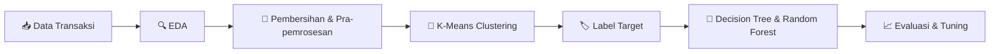
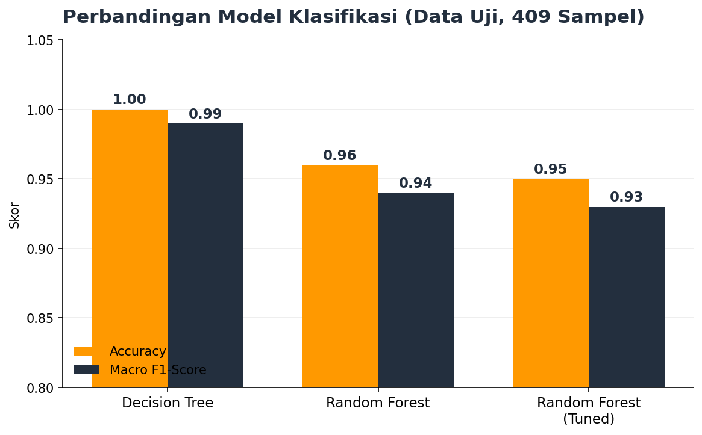

<div align="center">

# 🏦 Bank Transaction Segmentation & Classification
### Proyek Akhir Machine Learning — AWS Academy 2026 × Dicoding

*Menggabungkan **Unsupervised Learning (Clustering)** dan **Supervised Learning (Klasifikasi)** pada data transaksi perbankan*


</div>

---

## 📌 Ringkasan

Repositori ini berisi **proyek akhir** dari kelas spesial **AWS Academy 2026 yang diselenggarakan Dicoding**. Proyek ini menguji kemampuan menerapkan *supervised* dan *unsupervised learning* secara berurutan dalam satu alur kerja nyata:

1. **Clustering:** mengelompokkan transaksi nasabah untuk menghasilkan label kelas.
2. **Klasifikasi:** melatih model yang memprediksi label tersebut dari fitur transaksi.



---

## 🎯 Tujuan

- Melakukan *exploratory data analysis* (EDA) dan pembersihan data transaksi bank.
- Mengelompokkan nasabah dengan **K-Means** dan mengukur kualitasnya dengan *Silhouette Score*.
- Mengubah hasil cluster menjadi label (`Target`) untuk model klasifikasi.
- Membandingkan beberapa algoritma klasifikasi dan melakukan *hyperparameter tuning*.

---

## 🗂️ Dataset

Dataset adalah versi modifikasi dari Kaggle **"Bank Transaction Dataset for Fraud Detection"**, yang disediakan oleh Dicoding untuk keperluan penilaian. Isinya menggambarkan perilaku transaksi dan pola aktivitas keuangan nasabah.

| Atribut | Keterangan |
|---|---|
| Baris awal | 2.537 |
| Kolom | 16 |
| Lokasi | Kota-kota di Amerika Serikat |
| Setelah pembersihan | 1.945 baris (clustering) |

### Fitur

| Kelompok | Kolom |
|---|---|
| 🆔 **Identitas** | `TransactionID`, `AccountID`, `DeviceID`, `MerchantID`, `IP Address` |
| 💳 **Transaksi** | `TransactionAmount`, `TransactionType` (Credit/Debit), `Channel` (ATM/Online/Branch), `TransactionDuration`, `LoginAttempts` |
| 👤 **Nasabah** | `CustomerAge`, `CustomerOccupation`, `AccountBalance` |
| 🕒 **Waktu & Tempat** | `TransactionDate`, `PreviousTransactionDate`, `Location` |

---

## 🧩 Tahap 1: Clustering

### Pra-pemrosesan

| Langkah | Metode |
|---|---|
| Data hilang | `dropna()` (± 20–30 nilai kosong per kolom) |
| Duplikat | `drop_duplicates()` (21 baris duplikat) |
| Kolom tidak relevan | Hapus kolom berisi `id`, `ip`, dan `date` |
| Encoding kategorikal | `LabelEncoder` |
| Outlier | Metode **IQR** (1,5 × IQR) |
| Skala fitur | `StandardScaler` |
| Rekayasa fitur | *Binning* `CustomerAge` menjadi **Muda / Dewasa / Lansia** |

### Pemodelan

- **Algoritma:** K-Means
- **Penentuan jumlah cluster:** `KElbowVisualizer` dengan metrik *silhouette* pada k = 2 sampai 10
- **Hasil:** **k = 2**
- **Silhouette Score:** **0,572**
- **Visualisasi:** reduksi dimensi **PCA** (2 komponen)
- **Model pembanding:** K-Means pada data hasil PCA

### Interpretasi

| Cluster | Ciri utama |
|---|---|
| **Cluster 0** | Nasabah di kota berawalan **A–L**, rata-rata transaksi ≈ 255,55, usia ≈ 45 tahun |
| **Cluster 1** | Nasabah di kota berawalan **M–W**, rata-rata transaksi ≈ 258,15, usia ≈ 44 tahun |

> 💬 Fitur numerik kedua cluster nyaris sama (selisih rata-rata di bawah 0,06 simpangan baku). Pemisah utamanya adalah `Location` hasil *label encoding*. Ini dibahas terbuka di bagian [Catatan](#-catatan-dan-keterbatasan).

---

## 🌳 Tahap 2: Klasifikasi

Label dari clustering dipakai sebagai `Target`, lalu data dibagi **80% latih : 20% uji** dengan `stratify` agar proporsi kelas terjaga.

| Data | Jumlah |
|---|---:|
| Total | 2.042 |
| Latih | 1.633 |
| Uji | 409 |

### Hasil Evaluasi



| Model | Accuracy | Macro F1 |
|---|---:|---:|
| **Decision Tree** | **1,00** | 0,99 |
| Random Forest | 0,96 | 0,94 |
| Random Forest (*GridSearchCV*) | 0,95 | 0,93 |

**Hyperparameter tuning** memakai `GridSearchCV` (5-fold CV) dengan ruang pencarian:

| Parameter | Nilai yang diuji |
|---|---|
| `n_estimators` | 50, 100, 200 |
| `max_depth` | None, 10, 20 |
| `min_samples_split` | 2, 5 |

Konfigurasi terbaik: `n_estimators=50`, `max_depth=None`, `min_samples_split=2`.

---

## 🧰 Teknologi

| Kategori | Library |
|---|---|
| Data | `pandas`, `numpy` |
| Visualisasi | `matplotlib`, `seaborn`, `yellowbrick` |
| Machine Learning | `scikit-learn` (KMeans, PCA, DecisionTree, RandomForest, GridSearchCV) |
| Penyimpanan model | `joblib` |
| Lingkungan | Jupyter Notebook / Google Colab |

---

## 📁 Struktur Repositori

```
AWS-Academy-2026-Dicoding/
├── assets/
│   └── model-comparison.png                     # Grafik untuk README
├── [Clustering]_Submission_Akhir_BMLP_Ashafa_Multazam.ipynb
├── [Klasifikasi]_Submission_Akhir_BMLP_Ashafa_Multazam.ipynb
├── bank_transactions_data_edited.csv            # Dataset
├── bank_transactions_data_edited .xlsx          # Dataset (Excel)
├── model_clustering.h5                          # K-Means
├── PCA_model_clustering.h5                      # K-Means pada data PCA
├── decision_tree_model.h5                       # Decision Tree
├── explore_RandomForest_classification.h5       # Random Forest
├── tuning_classification.h5                     # Random Forest hasil tuning
├── submision dicoding.docx                      # Ketentuan submission
└── README.md
```

---

## 🚀 Cara Menjalankan

1. **Clone repositori**
   ```bash
   git clone https://github.com/ashafamultazam/AWS-Academy-2026-Dicoding.git
   cd AWS-Academy-2026-Dicoding
   ```
2. **Pasang dependensi** (disarankan scikit-learn 1.7.0)
   ```bash
   pip install pandas numpy matplotlib seaborn yellowbrick scikit-learn==1.7.0 joblib jupyter
   ```
3. **Jalankan notebook secara berurutan:**
   1. `[Clustering]_Submission_Akhir_BMLP_Ashafa_Multazam.ipynb`
   2. `[Klasifikasi]_Submission_Akhir_BMLP_Ashafa_Multazam.ipynb`

**Memuat model tersimpan:**

```python
import joblib

kmeans = joblib.load("model_clustering.h5")
clf    = joblib.load("decision_tree_model.h5")
```

> Model memakai ekstensi `.h5` sesuai ketentuan submission, tetapi disimpan dengan `joblib` (bukan format HDF5). Muat dengan `joblib.load`, bukan `h5py`.

---

## 📝 Catatan dan Keterbatasan

Bagian ini sengaja ditulis terbuka agar hasil proyek dibaca dengan benar:

- **Pemisahan cluster didominasi `Location`.** Fitur numerik kedua cluster hampir identik. Karena `Location` di-*label encode* secara alfabetis, cluster cenderung terbelah menjadi kota A–L dan M–W. Artinya, cluster belum menggambarkan segmen perilaku nasabah yang bermakna secara bisnis.
- **Akurasi mendekati sempurna wajar, tetapi jangan ditafsirkan berlebihan.** Label `Target` dihasilkan dari fitur yang sama melalui clustering, sehingga model klasifikasi pada dasarnya mempelajari ulang aturan pembentuk cluster. Skor tinggi belum membuktikan kemampuan prediksi pada data baru.
- **Notebook klasifikasi memuat dataset hasil clustering dari sumber terpisah** (2.042 baris, 6 kelas), sedangkan notebook clustering menghasilkan 2 cluster dari 1.945 baris. Alur keduanya belum sepenuhnya satu rantai.
- **Sebagian kolom numerik terbaca sebagai teks** pada notebook klasifikasi (contoh nilai `14.089.999.999.999.900`) akibat format angka, sehingga ikut ter-*one-hot encode*. Memperbaiki tipe datanya akan membuat model lebih ringkas dan evaluasinya lebih jujur.
- `LoginAttempts` bernilai konstan (1) setelah penghapusan outlier, sehingga tidak berkontribusi pada pemisahan cluster.

### 🔭 Pengembangan Selanjutnya

- Gunakan **one-hot encoding** untuk `Location` atau hapus dari clustering, agar cluster ditentukan perilaku transaksi.
- Tambahkan fitur turunan, misalnya selisih `TransactionDate` dan `PreviousTransactionDate`.
- Evaluasi dengan validasi silang yang tidak bocor dan metrik tambahan (confusion matrix).
- Coba algoritma lain: DBSCAN, Gaussian Mixture, atau Gradient Boosting.

---

## 👤 Penulis

**Ashafa Multazam** — [GitHub](https://github.com/ashafamultazam)

## 🙏 Ucapan Terima Kasih

- **Dicoding Indonesia** dan **AWS Academy** atas materi dan kesempatan belajar
- Pembuat dataset *Bank Transaction Dataset for Fraud Detection* di Kaggle

---

<div align="center">

⭐ Jika proyek ini bermanfaat, beri bintang pada repositori ini.

</div>
